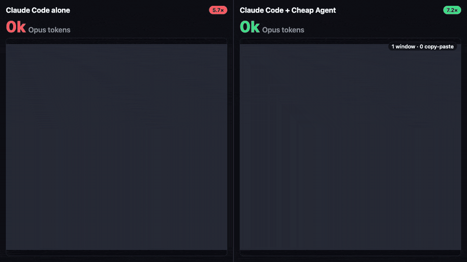
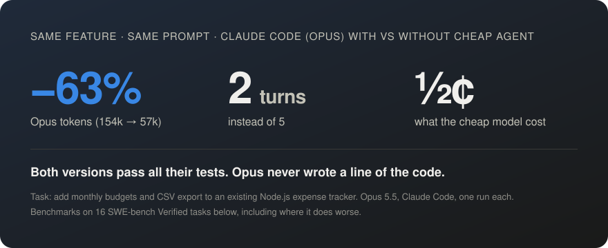
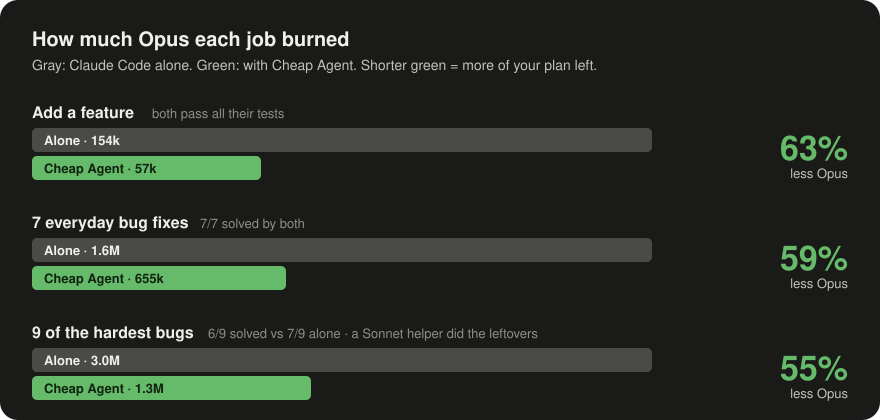
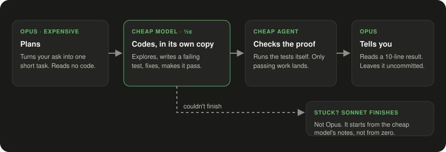

<h1 align="center">Cheap Agent</h1>

<p align="center">
  <em>Your Opus is a principal engineer. Stop paying it to type.</em>
</p>

<p align="center">
  
  
  
  
  
</p>

<p align="center">
  
</p>

<p align="center">
  
</p>

<p align="center">
  <strong>Same feature. Same prompt. 63% fewer Opus tokens.</strong><br>
  <strong>Your Claude plan lasts longer. Your code still ships with tests.</strong>
</p>

---

You know the principal engineer. Twenty years in. Sees the whole system at once. Costs a fortune per hour.

You would never pay them to type out a CSV exporter.

But that's exactly what happens every time Opus writes your code: the most expensive model you have, reading files, typing boilerplate, re-running tests, burning through your plan.

**Cheap Agent fixes the org chart.** Opus plans and decides. A model that costs half a cent per task does the typing, in its own copy of your project, and has to prove its work with a test before anything reaches you.

## Why I built this

The idea: get **$200-plan usage out of the $100 Claude plan**, and **$50–70 worth out of the $20 plan**, with a few dollars of DeepSeek doing the typing.

I've met a lot of students, mostly in developing countries, who really want Opus for the hard problems and simply can't afford $100 a month. I wanted to find something that helps them.

This is a small effort from my side. It won't make Opus ten times cheaper. But stretching the plan you already pay for is something, and something is better than nothing.

## Install

**Easiest:** paste this into Claude Code. It asks what you want, then gives you one command to run.

```text
Set up Cheap Agent (npm: cheap-agent) for me.
1. Ask me: which provider (OpenRouter recommended, DeepSeek or OpenCode Go), and which
   models (balanced is the default; cheapest, strongest, or my own provider/model).
2. Check that node is 20+ and the claude CLI is installed.
3. If I picked my own model, save {"models":{"implement":"<model>"}} in
   ~/.config/cheapag/config.json, keeping what else is there.
4. Give me the command to run in my terminal: npx cheap-agent login --preset <my choice,
   or custom>, and which number to pick for my provider (1 OpenCode Go, 2 OpenRouter,
   3 DeepSeek). I run it and type my API key there. Never ask for my key.
5. When I say done, check `claude mcp list` shows cheapag, then tell me to run
   /cheapag:allow in a new Claude Code session in my project.
```

**Or do it yourself:**

```bash
npx cheap-agent
```

Pick a provider (**OpenRouter** if unsure), press Enter for the recommended models, paste your API key. It checks the key works, then adds itself to Claude Code for every project.

Then, in each project, once:

```
/cheapag:allow
```

**That's it.** Ask Claude for changes like you always do.

**You need:**
- [Claude Code](https://claude.com/claude-code)
- [Node.js](https://nodejs.org) 20+
- An API key with a few dollars on it from [OpenRouter](https://openrouter.ai/keys), [DeepSeek](https://platform.deepseek.com) or [OpenCode Go](https://opencode.ai)

A few dollars lasts hundreds of tasks. It runs on macOS and Linux.

**Windows (beta):** tested in CI, not yet by a Windows user. You also need [Git for Windows](https://git-scm.com/downloads/win) (Git Bash). Known so far:
- The very first job can take about 2 minutes while the cheap model's engine (OpenCode) sets itself up. Later jobs start in seconds.
- If that engine crashes mid-session, Cheap Agent starts a new one, but the crashed copy can stay running (`opencode.exe` in Task Manager) until you end it or restart.
- The cheap model can't read your dependency folders (like `node_modules`) inside its copy of the project. Your tests still run normally.

## The numbers

Tested on [SWE-bench Verified](https://www.swebench.com): real bugs from real open-source projects, graded by the official harness. Same prompts in Claude Code with Opus 5.5, with and without Cheap Agent.

<p align="center">
  
</p>

**What I won't hide:**
- On the very hardest bugs it solved 6 of 9 where plain Opus solved 7 (on a single run plain Opus averages about 6 too).
- On tiny jobs (a few lines, or a whole small app from nothing), Opus is already quick, so there's nothing to save.

Cheap Agent shines on the work in between: real features and real fixes in real code. That's most of your day.

## Before / after

**The ask:** *"Add monthly budgets to the expense tracker, plus a CSV export. Tests for everything."*

|  | Claude Code alone | Claude Code + Cheap Agent |
|---|---|---|
| Opus tokens | 154k | **57k** |
| Opus turns | 5 | **2** |
| Who wrote the code | Opus | a cheap model, for **$0.005** |
| Tests | 33 passing | **38 passing** |

Opus wrote one task. The cheap model did the rest, tests included.

## Built with itself

Native Windows support (36 files, +753/−278 lines) was built with Cheap Agent. Claude found the problems and wrote the plans. The cheap model wrote the code in 30 jobs for **$0.29 in total**, Sonnet helpers finished what it couldn't and read OpenCode's source to find the two Windows-only bugs, and the full test suite now passes on Linux and Windows.

## How it works

<p align="center">
  
</p>

- **Every change is proven.** The cheap model must write a test that fails before its fix and passes after. Cheap Agent runs the tests itself; it doesn't take the model's word for it.
- **Your project stays clean.** Work happens in a private copy (a git worktree). Only passing work lands, uncommitted, so you review the diff like any other.
- **Opus stays in charge,** but it's held to it: Cheap Agent's hooks stop Opus from quietly redoing work that already passed, or doing a failed step itself when Sonnet can.

## Commands

| Command | What it does |
|---|---|
| `/cheapag:allow` | Your OK to send this project's code to the cheap model. Once per project. |
| `/cheapag:status` | Recent jobs, and what the cheap model has cost you. |
| `/cheapag:hook on` | No more "I'll just do it myself": Claude *must* hand code changes to the cheap model. |
| `/cheapag:clean` | Tidy up old job folders. |

## Settings

Optional. Put a `cheapag.json` in a project:

| Setting | Default | What it does |
|---|---|---|
| `takeover` | `"sonnet"` | Who finishes a step the cheap model couldn't: a Sonnet helper, or `"self"` (Opus, capped at 15 tool calls). |
| `limits.max_turns` | `25` | The most turns the cheap model gets per step. |
| `models` | from setup | Which cheap models to use. Switch with `npx cheap-agent login --preset strongest`. |

## FAQ

**Is a half-cent model actually any good?**
On its own, no. With a written task from Opus, a test it has to pass, and a referee that runs that test, yes, most of the time. When it isn't, it says so and Sonnet takes over.

**Does Claude check the work?**
The tests check the work, and Cheap Agent runs them. Opus checking every passing change cost three times the tokens and caught nothing in my runs, so it trusts a pass. You still review the diff before you commit.

**Where does my code go?**
To the provider you picked, only after you run `/cheapag:allow` in that project, which also shows exactly which models will see it. Your API key stays on your machine, in a hidden prompt and a local credential store, never in chat.

**Will it commit or push anything?**
Never. Changes land uncommitted. Your git, your call.

**Why not just use Sonnet for everything?**
Sonnet still costs real usage on every line it types. The cheap model types for half a cent. Sonnet only gets called when the cheap model is stuck.

**Can I use it at work, or build on it?**
Yes. It's MIT licensed: use it, change it, share it, at any company, for free ([MIT License](./LICENSE)).

**Why "Cheap Agent"?**
Because your plan isn't.

## Update or remove

**Update:**

```bash
npx cheap-agent@latest
```

**Remove** (two commands):

```bash
claude plugin uninstall cheapag@cheapag
```

```bash
claude mcp remove -s user cheapag
```
